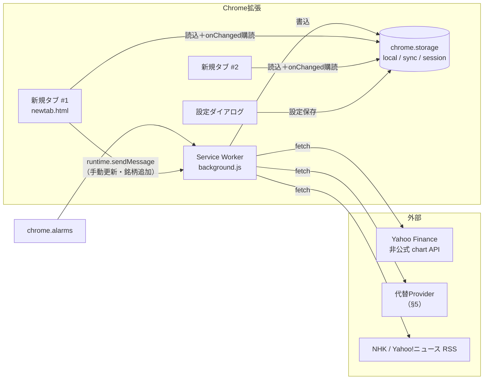
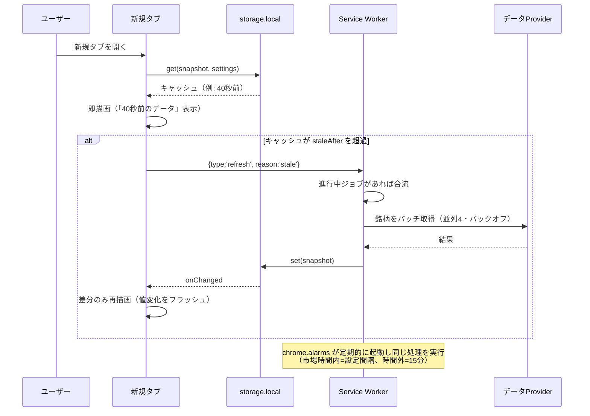

# マーケット新規タブ 設計書

| 項目 | 内容 |
|---|---|
| 文書版数 | 2.1（v2.0 実装反映） |
| 作成日 | 2026-11-20 |
| 対象 | Chrome 拡張「マーケット新規タブ」v2.0 |
| 前提 | 現行 v1.0（`manifest.json` / `newtab.html` / `newtab.css` / `newtab.js`）を土台に拡張する |

---

## 1. 概要

### 1.1 目的

Chrome の新規タブを開いた瞬間に、日本の個人投資家が「今日の相場の状況」を 1 秒以内に把握できるダッシュボードを表示する。証券会社のツールやポータルサイトを開く前の「最初の一瞥」を担う。

### 1.2 想定ユーザー

| ペルソナ | 特徴 | 主なニーズ |
|---|---|---|
| A. 兼業の個人投資家（中心） | 会社員。取引は昼休みと夜。新NISA で日本株・米国株インデックスを保有 | 日経平均・ドル円・米国指数をひと目で。保有銘柄の騰落。決算日の把握 |
| B. 積極的な個別株トレーダー | 日中も相場を見る。信用取引あり | 先物・夜間の動き、ウォッチリストの高頻度更新、適時開示 |
| C. 長期・資産形成層 | 頻繁には見ない | 大きな変化だけ分かればよい。オルカン・S&P500 の基準価額相当 |

### 1.3 設計方針

1. **一瞥性**：最重要情報（日経平均・TOPIX・ドル円・NYダウ/S&P500）はファーストビューの上段に固定。
2. **即時表示**：新規タブを開くたびに通信しない。バックグラウンドで更新したキャッシュを即描画する（v1 からの最大の変更点）。
3. **日本の慣習**：上昇=赤／下落=青を既定、和暦ではなく西暦、東証の取引時間・祝日・昼休みを正しく扱う。
4. **投資助言をしない**：事実の表示に留め、売買推奨・スコアリングは行わない（§11）。
5. **プライバシー**：ウォッチリストや保有情報を外部サーバーに送らない。自前サーバーを持たない。

### 1.4 スコープ

| 区分 | 内容 |
|---|---|
| 対象 | 指数・為替・金利・商品・暗号資産の表示、ウォッチリスト、簡易ポートフォリオ、ニュース、経済指標／決算カレンダー、市場開閉表示 |
| 対象外 | 発注・口座連携、リアルタイム板情報、売買シグナル、チャートのテクニカル分析、有料情報の再配信 |

---

## 2. 現行 v1.0 の整理と課題

### 2.1 現行機能

README の通り。国内指数・為替・海外指数・金利/商品/暗号資産・ウォッチリスト（ヒートマップ）・経済ニュース（NHK/Yahoo!）、期間切替、自動更新、騰落色切替、`chrome.storage.sync` 保存。

### 2.2 課題

| # | 課題 | 影響 | v2 での対応 |
|---|---|---|---|
| P1 | 新規タブを開くたびに約 30 銘柄を `fetch` している（`refresh()` を `init` で即実行） | タブを多く開く人ほど通信量・相手サーバー負荷が増え、レート制限で取得失敗しやすい | Service Worker で一元取得し、ページはキャッシュを読むだけにする（§4） |
| P2 | 祝日を考慮していない（README に明記） | 祝日に「取引中」と誤表示 | 祝日カレンダーを同梱＋年次更新（§6.4） |
| P3 | TOPIX を 1306 ETF で代用 | 指数値と乖離（分配落ち等） | 代替データソースで指数値を取得。取れない場合は「ETF 代用」と明示（§5.3） |
| P4 | データソースが Yahoo Finance の非公式 API のみ | 仕様変更で全面停止。公開配布時の規約リスク | データソース抽象化層（Provider）で差し替え可能にする（§5） |
| P5 | ニュース RSS の取得もページ内で毎回実行 | P1 と同じ | Service Worker で 10 分間隔に集約 |
| P6 | 期間を切り替えるとキャッシュを捨てて全件再取得 | 体感が遅い | 期間ごとにキャッシュを分ける |
| P7 | ウォッチリストの銘柄名が辞書（`JP_NAMES`）頼み | 辞書にない銘柄は英語名 | 東証上場銘柄マスタを同梱（§5.4） |
| P8 | `newtab.js` 1 ファイル約 500 行に責務が混在 | 機能追加で保守が難しくなる | モジュール分割（§4.3） |

---

## 3. 機能要件

優先度：**M**=必須（v2.0）、**S**=推奨（v2.1）、**C**=将来

### 3.1 ヘッダー

| ID | 機能 | 優先度 | 詳細 |
|---|---|---|---|
| H-1 | 日付・時計 | M | 日本時間。`2026年11月20日(金) 10:15:32` 形式 |
| H-2 | 市場開閉表示 | M | 東京（前場・昼休み・後場・閉場・休場）、ロンドン、NY、＋大阪取引所の夜間取引（先物）。祝日・夏時間対応。次の開場までの残り時間をツールチップ表示 |
| H-3 | 検索 | M | 既定は Google 検索。4 桁（英字入り含む `285A` 等）コードは銘柄ページへ。銘柄名の部分一致サジェスト（銘柄マスタ利用） |
| H-4 | 期間切替 | M | 1日/5日/1ヶ月/6ヶ月/1年/5年。全チャートに一括適用 |
| H-5 | 手動更新・設定 | M | ⟳ で即時更新を Service Worker に依頼 |

### 3.2 マーケットパネル

| ID | パネル | 優先度 | 表示項目 |
|---|---|---|---|
| M-1 | 国内指数 | M | 日経平均、TOPIX、日経225先物（大阪・夜間含む）、東証グロース250、JPX日経400（S）、東証REIT指数（S） |
| M-2 | 為替 | M | USD/JPY、EUR/JPY、GBP/JPY、AUD/JPY、CNY/JPY、EUR/USD。ドル円は大きめに表示 |
| M-3 | 海外指数 | M | NYダウ、S&P500、NASDAQ総合、SOX、ハンセン、DAX、上海総合（S）、MSCI ACWI 相当（オルカン参考、S） |
| M-4 | 金利・商品・暗号資産 | M | 日本10年国債利回り、米10年債利回り、VIX、WTI、金（ドル建）、金（円建・国内小売参考、S）、BTC/JPY |
| M-5 | 騰落サマリー | S | 東証プライムの値上がり/値下がり銘柄数、売買代金（取得可能な場合のみ） |

各カードの共通表示：名称、現在値、前日比（額・率）、スパークライン（前日終値の点線つき）、データ時刻、遅延表示（例「20分遅延」）。

### 3.3 ウォッチリスト

| ID | 機能 | 優先度 | 詳細 |
|---|---|---|---|
| W-1 | 銘柄追加・削除 | M | コード、または銘柄名（サジェスト）で追加。米国株ティッカー（`AAPL`）も可 |
| W-2 | 並べ替え | M | ドラッグ&ドロップ／列ヘッダで騰落率・コード順ソート |
| W-3 | 複数リスト | S | 「保有」「監視」など最大 5 リスト、各 50 銘柄まで |
| W-4 | ヒートマップ | M | 騰落率で着色（±3% で最大濃度）。タイルサイズは均等（時価総額比例は C） |
| W-5 | 指標列 | S | 52週レンジ、出来高（前日比）、PER/PBR/配当利回り（取得可能なら） |
| W-6 | 決算日表示 | S | 直近 7 日以内に決算発表がある銘柄にバッジ |
| W-7 | インポート/エクスポート | S | CSV（`コード,メモ`）で入出力 |

### 3.4 簡易ポートフォリオ（S）

| ID | 機能 | 詳細 |
|---|---|---|
| PF-1 | 保有登録 | 銘柄・株数・平均取得単価・口座区分（特定/一般/NISA成長/NISAつみたて） |
| PF-2 | 評価額 | 評価額、評価損益（額・率）、本日の損益。外貨建ては当日レートで円換算 |
| PF-3 | 構成比 | 銘柄別・口座区分別のドーナツチャート |
| PF-4 | 金額の非表示 | 👁 ボタンで金額を `****` に。画面共有時の配慮。既定は設定で選択 |

保有データは `chrome.storage.local` のみに保存し、同期（sync）しない（§8.3）。

### 3.5 ニュース・カレンダー

| ID | 機能 | 優先度 | 詳細 |
|---|---|---|---|
| N-1 | 経済ニュース | M | NHK 経済、Yahoo!ニュース経済。タブ切替。既読は薄く表示 |
| N-2 | 適時開示 | S | ウォッチリスト銘柄の TDnet 開示を一覧（取得手段は §5.2 の検討事項） |
| N-3 | 経済指標カレンダー | S | 今日・明日の主要指標（日銀会合、FOMC、米雇用統計、CPI、日本 GDP、日銀短観、SQ 日）。同梱 JSON＋手動更新 |
| N-4 | 決算カレンダー | S | ウォッチリスト銘柄の決算予定日 |

### 3.6 設定

| 項目 | 既定値 | 選択肢 |
|---|---|---|
| 騰落の色 | 日本式（赤上昇） | 日本式／海外式 |
| テーマ | OS に追従 | ライト／ダーク／OS |
| 自動更新間隔 | 1 分 | 30秒／1分／5分／15分／しない |
| 市場時間外の更新 | 15 分 | 更新間隔と同じ／15分／しない |
| 表示パネル | 全部 | パネルごとに表示/非表示・並べ替え |
| 情報密度 | 標準 | コンパクト／標準 |
| ニュース既定ソース | NHK | NHK／Yahoo! |
| 検索エンジン | Google | Google／Bing／Yahoo! JAPAN／DuckDuckGo |
| 金額の初期表示 | 表示 | 表示／非表示 |
| ウォッチリスト初期化 | — | ボタン |

---

## 4. アーキテクチャ

### 4.1 全体構成



**要点**

- 外部への通信は **Service Worker（SW）だけ** が行う。新規タブは `chrome.storage.local` のキャッシュを読んで即描画し、`chrome.storage.onChanged` で更新を受け取る。
- タブを 10 枚開いても通信は 1 系統。v1 の P1・P5 を解消する。
- 新規タブが開かれたとき、キャッシュが古ければ（既定 60 秒超）SW に `refresh` を依頼する。SW 側は進行中の取得があれば合流（重複排除）する。

### 4.2 更新シーケンス



### 4.3 モジュール構成（ファイル）

ビルドツールは使わず、ES Modules（`<script type="module">`、SW は `"type": "module"`）で分割する。依存ライブラリなし（チャートは自前 SVG を継続）。

```
manifest.json
background.js                 SW エントリ。alarms・メッセージ受付
newtab.html / newtab.css
src/
  core/
    config.js                 指数・為替などの定義、既定設定、リンク先
    market-calendar.js        取引時間・祝日・夏時間・SQ 判定
    format.js                 数値・日時の書式
    symbols.js                コード正規化、表示名、ローカル検索
    storage.js                storage ラッパ（拡張外は localStorage）＋スキーマ移行
    portfolio.js              評価額・損益の計算
  data/
    scheduler.js              取得ジョブ、重複排除、並列制御、バックオフ、更新間隔の計算
    news.js                   RSS 取得・解析（SW に DOMParser が無いため正規表現）
    providers/yahoo.js        Yahoo chart API（＋検索 API）
    providers/mof.js          財務省 国債金利 CSV（Shift_JIS）
    providers/mock.js         開発用ダミーデータ（?mock）
  ui/
    app.js                    新規タブのエントリ（状態・購読・描画の統括）
    client.js                 SW へのメッセージ送信（拡張外は直接呼び出し）
    header.js / panels.js / watchlist.js / portfolio.js / calendar.js / news.js
    settings.js / suggest.js / sparkline.js
  static/
    holidays.js               日本・米国・英国の休場日（年次更新）
    events.js                 日銀・FOMC などの日程（年次更新）
    symbols-jp.js             主要銘柄の日本語名・読み（約120件）
tests/
  core.test.js                単体テスト（node --test）
  smoke.mjs                   実データ取得元への接続確認
  sw-sim.mjs                  chrome.* をフェイクして background.js を Node 上で実行
  fixtures/                   実レスポンスのサンプル
tools/devserver.py            開発用サーバー（キャッシュ無効）
```

> 実装メモ: 静的データは当初 JSON の想定だったが、SW・ページ・Node のテストから同じ形で import できるよう ES Modules（.js）にした。

### 4.4 manifest.json（v2）

```json
{
  "manifest_version": 3,
  "name": "マーケット新規タブ",
  "version": "2.0.0",
  "description": "新規タブに日本の金融市場ダッシュボードを表示します。",
  "minimum_chrome_version": "120",
  "chrome_url_overrides": { "newtab": "newtab.html" },
  "background": { "service_worker": "background.js", "type": "module" },
  "permissions": ["storage", "alarms"],
  "host_permissions": [
    "https://query1.finance.yahoo.com/*",
    "https://query2.finance.yahoo.com/*",
    "https://www3.nhk.or.jp/*",
    "https://news.yahoo.co.jp/*"
  ],
  "content_security_policy": {
    "extension_pages": "script-src 'self'; object-src 'self'; img-src 'self' data:"
  },
  "icons": { "16": "icons/icon16.png", "48": "icons/icon48.png", "128": "icons/icon128.png" }
}
```

- `minimum_chrome_version: 120`：`chrome.alarms` の最短周期 30 秒が使える版。
- `tabs`・`history` 等の権限は要求しない（ストア審査・ユーザーの信頼のため最小権限）。
- 代替 Provider を追加する場合は `optional_host_permissions` とし、設定画面で利用者が有効化したときに `chrome.permissions.request` する。

---

## 5. データ設計

### 5.1 Provider 抽象化

```js
/**
 * @typedef {Object} Quote
 * @property {string} sym          内部シンボル（例 '7203.T', '^N225'）
 * @property {number|null} price   現在値
 * @property {number|null} prev    前日終値（前営業日の終値）
 * @property {number|null} chg     前日比
 * @property {number|null} pct     前日比率（%）
 * @property {number|null} rangeBase  期間騰落の基準値
 * @property {number|null} rangePct
 * @property {number|null} dayHi
 * @property {number|null} dayLo
 * @property {number|null} hi52
 * @property {number|null} lo52
 * @property {number|null} volume
 * @property {string} currency     'JPY' | 'USD' ...
 * @property {number} time         取引時刻（UNIX 秒）
 * @property {number} delayMin     遅延分数（不明なら -1）
 * @property {[number, number][]} pts  [UNIX秒, 終値]
 * @property {string} source       Provider ID
 * @property {boolean} proxy       代用値なら true（例: TOPIX を ETF で代用）
 */

/** Provider インターフェース */
export const Provider = {
  id: 'yahoo',
  supports(sym) {},                     // そのシンボルを扱えるか
  async fetchQuote(sym, range) {},      // → Quote
  rateLimit: { concurrency: 4, minIntervalMs: 150 },
};
```

- シンボルごとに **優先 Provider リスト** を持ち、失敗したら次へ（例：TOPIX は `[alt:topix-index, yahoo:1306.T(proxy)]`）。
- 取得結果は Provider に依存しない `Quote` に正規化してから保存する。UI は Provider を意識しない。

### 5.2 データソース

| データ | 第一候補 | 備考・リスク |
|---|---|---|
| 指数・為替・米国株・商品・暗号資産 | Yahoo Finance chart API（v1 と同じ） | 非公式。予告なく仕様変更・遮断の可能性。**個人利用前提**。ストア公開する場合は §11.2 の検討が必須 |
| 日本株（個別） | 同上 | 約 20 分遅延 |
| TOPIX 指数値 | 公式指数値を提供する API を調査（JPX 系の有償/無償 API） | 見つからない場合は v1 同様 1306 ETF 代用＋「ETF代用」バッジ |
| 日本10年国債利回り | 財務省「国債金利情報」CSV（日次） | 日次更新のためスパークラインは 1ヶ月以上のみ。1日表示では前日比のみ |
| ニュース | NHK・Yahoo!ニュースの公開 RSS | 見出しとリンクのみ表示。本文は取得しない |
| 適時開示 | 公式に機械取得が許可された手段がある場合のみ実装 | 規約未確認のため v2.0 では TDnet への**リンクのみ** |
| 祝日 | 内閣府「国民の祝日」CSV を元に同梱 JSON 化 | 東証独自の休業日（12/31〜1/3）を加える |
| 経済イベント | 手動で作成した同梱 JSON | 日銀・FOMC の日程は各公式発表から年次で作成 |
| 銘柄マスタ | JPX「東証上場銘柄一覧」（月次公開の Excel）を変換して同梱 | 新規上場は月次差。未収録コードは Provider の名称で補完 |

> 実装着手前に、各ソースの利用規約・robots・再配布可否を確認し、本表を更新すること（§13 のリスク R1）。

### 5.3 シンボル定義（config.js）

v1 の配列構造を拡張する。

```js
export const PANELS = {
  domestic: {
    title: '国内指数',
    items: [
      { id: 'n225',  n: '日経平均株価', src: [['yahoo', '^N225']], d: 2, url: 'https://finance.yahoo.co.jp/quote/998407.O' },
      { id: 'topix', n: 'TOPIX',        src: [['alt', 'TOPIX'], ['yahoo', '1306.T', { proxy: true }]] },
      { id: 'nk_f',  n: '日経225先物',   src: [['yahoo', 'NIY=F']], note: 'CME 円建' },
      { id: 'g250',  n: 'グロース250',   src: [['yahoo', '2516.T', { proxy: true }]] },
    ],
  },
  // fx, global, rates ... 同様
};
```

### 5.4 銘柄マスタ（tse-symbols.json）

```json
{ "updated": "2026-11-01",
  "items": [ ["7203", "トヨタ自動車", "トヨタ", "P", "輸送用機器"], ... ] }
```

配列タプル（コード, 正式名, 略称, 市場区分 P/S/G, 業種）でサイズを抑える（約 4,000 件で 300KB 程度を想定）。検索はかな/カナ・全角半角を正規化して前方一致→部分一致の順。

### 5.5 ストレージスキーマ

| 領域 | キー | 内容 | 上限への配慮 |
|---|---|---|---|
| `sync` | `settings` | §3.6 の設定値 | 1 項目 8KB 以内 |
| `sync` | `watchlists` | `[{id, name, syms: string[]}]` | 5 リスト×50 銘柄で約 4KB。sync 全体 100KB 以内 |
| `sync` | `schemaVersion` | 数値 | — |
| `local` | `snapshot:{range}` | `{ ts, quotes: {sym: Quote} }` 期間ごと | pts を間引き（最大 120 点） |
| `local` | `news:{src}` | `{ ts, items: [{title, link, date}] }` | 30 件 |
| `local` | `portfolio` | 保有一覧 | **同期しない** |
| `local` | `readNews` | 既読リンクのハッシュ（直近 500 件） | — |
| `session` | `job` | SW の進行中ジョブ状態（SW 再起動時の重複防止） | — |

**移行**：起動時に `schemaVersion` を見て移行関数を順に適用する。v1 → v2 では `watch: string[]` を `watchlists: [{id:'default', name:'ウォッチ', syms: watch}]` に、v1 の個別キー（`range`, `colorMode` 等）を `settings` オブジェクトにまとめる。

---

## 6. 更新・キャッシュ戦略

### 6.1 更新タイミング

| 契機 | 処理 |
|---|---|
| `chrome.alarms`（`market-tick`） | 市場状況に応じた間隔で全シンボル更新 |
| 新規タブ表示 | キャッシュが `staleAfter` 超なら SW に更新依頼 |
| 手動 ⟳ | 即時更新（ただし直前 10 秒以内の更新があればスキップ） |
| 期間切替 | その期間のキャッシュがあれば即表示し、古ければ更新 |
| ウォッチリスト追加 | その 1 銘柄だけ取得 |

### 6.2 アダプティブな更新間隔

```
いずれかの対象市場が取引中（東京・大阪夜間・NY・暗号資産を除く）
  → 設定の更新間隔（既定 60 秒）
すべて閉場
  → 「市場時間外の更新」設定（既定 15 分）。為替・暗号資産のみ対象
土日（為替も休み）
  → 暗号資産のみ 15 分、他は更新しない
Chrome を最近使っていない（新規タブが直近 30 分開かれていない）
  → アラームを 30 分に延長
```

「取引中のシンボルだけを更新する」ことで、閉場後の日本株を何度も取りに行かない。

### 6.3 取得の制御

- 同時接続：Provider ごとに 4 本まで。リクエスト間隔 150ms 以上。
- 失敗時：指数バックオフ（1s→2s→4s、最大 3 回）。HTTP 429 を受けたら Provider 全体を 5 分間停止。
- 部分失敗：取得できたシンボルだけ更新し、失敗分は前回値を保持して「⚠ 更新失敗（10:05 の値）」と表示。
- 期間データ：`1d` は毎回、`5d` は 5 分、`1mo` 以上は 1 時間に 1 回で十分（日足のため）。現在値だけを `1d` の結果から上書きする。

### 6.4 市場カレンダー（market-calendar.js）

| 市場 | 時間（現地） | 補足 |
|---|---|---|
| 東証 現物 | 前場 9:00–11:30 / 後場 12:30–15:30 | 2024年11月から大引け 15:30。大発会・大納会も同時間 |
| 大阪取引所 先物 | 日中 8:45–15:45 / 夜間 17:00–翌6:00 | 夜間は翌営業日扱い |
| ロンドン | 8:00–16:30 | 英国夏時間は `Intl` のタイムゾーンで吸収 |
| NY | 9:30–16:00 | 米国の祝日・半日取引日（感謝祭翌日など）は同梱 JSON で管理 |
| 為替 | 月曜朝〜土曜早朝（日本時間） | |

- 時刻計算は常に `Intl.DateTimeFormat` の `timeZone` 指定で行い、ローカル時刻に依存しない（v1 の `zoneParts` を継承）。
- 東証休業日：`holidays-jp.json` の祝日＋振替休日＋ 12/31〜1/3。
- SQ 日（毎月第 2 金曜、3・6・9・12 月はメジャー SQ）を計算で求め、カレンダーに表示。
- 同梱 JSON の収録範囲を過ぎた場合は「祝日データが古い可能性があります」と表示（土日判定のみで継続）。

---

## 7. 画面設計

### 7.1 レイアウト（デスクトップ 1440px 幅）

```
┌──────────────────────────────────────────────────────────────────────────┐
│ ◆ 2026年11月20日(金)  ● 東京 取引中 10:15  ○ ロンドン  ○ NY   [検索……]  │
│   10:15:32           ● 先物 日中                         [1日|5日|…] ⟳ ⚙ │
├──────────────────────────────────────────────────────────────────────────┤
│ 最終更新 10:15:02（約20分遅延）                         ⚠ 1件取得失敗    │
├──────────────────────────────────────┬───────────────────────────────────┤
│ 国内指数                              │ 為替                              │
│ ┌日経平均─┐┌TOPIX──┐┌先物───┐┌G250─┐│ ドル/円  156.32  +0.41 ~~~~      │
│ │39,512   ││2,745  ││39,600 ││ 652 ││ ユーロ/円 …                        │
│ │+212(+.5%)│ …                      │                                   │
├──────────────────────────────────────┼───────────────────────────────────┤
│ 海外指数（NYダウ S&P NASDAQ SOX …）    │ 金利・商品・暗号資産              │
├──────────────────────────────────────┼───────────────────────────────────┤
│ ウォッチリスト [保有▼][監視]  [+追加]   │ 今日の予定                        │
│ ヒートマップ                           │ 08:50 日本 GDP速報                │
│ ┌────┬────┬────┐                     │ 22:30 米 新規失業保険申請          │
│ 一覧表（ソート可）                     ├───────────────────────────────────┤
│                                      │ 経済ニュース [NHK|Yahoo!]         │
├──────────────────────────────────────┤                                   │
│ ポートフォリオ（評価額・損益・構成比）  │                                   │
└──────────────────────────────────────┴───────────────────────────────────┘
```

### 7.2 レスポンシブ

| 幅 | 列数 | 調整 |
|---|---|---|
| ≥ 1280px | 3 列（2:1） | 上図 |
| 900–1279px | 2 列 | カレンダーをニュースの上に |
| < 900px | 1 列 | 国内指数カードを横スクロール、ヒートマップを 3 列に |

### 7.3 状態表示

| 状態 | 表示 |
|---|---|
| 初回（キャッシュなし） | スケルトン（灰色の矩形）。テキスト「取得中…」 |
| キャッシュ表示中・更新中 | ヘッダー下に「40秒前のデータ・更新中」とインジケーター |
| 値が変化 | 0.8 秒だけ背景を上昇色/下落色でフラッシュ（`prefers-reduced-motion` では無効） |
| 取得失敗 | 該当カードに ⚠ と最終取得時刻。全件失敗時はバナーで「データ提供元に接続できません」 |
| オフライン | `navigator.onLine === false` で「オフライン — 最後のデータを表示中」 |
| 休場日 | 東京セッションに「休場（勤労感謝の日）」 |
| 代用値 | 「ETF代用」小バッジ＋ツールチップで説明 |

### 7.4 配色・タイポグラフィ

- CSS 変数でトークン化（v1 の `--up` / `--down` / `--flat` / `--panel` / `--line` を継承）。
- 日本式：`--up` = 赤系、`--down` = 青系。海外式：`--up` = 緑系、`--down` = 赤系。
- 色だけに頼らず、必ず `+` / `−` の符号と ▲▼ を併記（色覚多様性への配慮）。
- 数値は `font-variant-numeric: tabular-nums` で桁を揃える。フォントは OS 標準（`system-ui, "Hiragino Sans", "Noto Sans JP", sans-serif`）。外部フォントは読み込まない。

### 7.5 操作

| 操作 | 動作 |
|---|---|
| カード/行クリック | 該当銘柄の Yahoo!ファイナンス（日本版）ページを同じタブで開く。Ctrl/⌘+クリックで別タブ |
| キーボード `/` | 検索欄にフォーカス |
| `r` | 手動更新 |
| `1`–`6` | 期間切替 |
| `h` | 金額の表示/非表示 |

キーボードショートカットは入力欄にフォーカスがある間は無効。

---

## 8. 非機能要件

### 8.1 性能

| 指標 | 目標 |
|---|---|
| 新規タブ表示 → キャッシュ描画完了 | 100ms 以内（ミドルクラス PC） |
| 初回（キャッシュなし）の全パネル表示 | 3 秒以内 |
| JS 合計サイズ（銘柄マスタ除く） | 100KB 以内（非圧縮） |
| 新規タブ 1 枚あたりのメモリ | 30MB 以内 |
| 1 時間あたりの外部リクエスト数（取引時間中・既定設定） | 約 60 回×シンボル数を上限とし、タブ数に比例しない |

実装上の注意：
- 銘柄マスタは検索欄にフォーカスしたときに遅延読み込み。
- 再描画はパネル単位で差分のみ。`innerHTML` 全置換は初回のみとし、以後は値のテキストノード更新とスパークラインの `d` 属性差し替え。

### 8.2 セキュリティ

- 外部由来の文字列（銘柄名・ニュース見出し・URL）は必ずエスケープ（v1 の `esc()` を継続）または `textContent` で挿入。
- リンクは `https?://` のみ許可（v1 と同じ）。ニュースのリンク先ドメインはフィードごとの許可リストで検証。
- CSP で外部スクリプト・`eval` を禁止。リモートコードは読み込まない（MV3 の要件）。
- RSS は `DOMParser` の `text/xml` で解析し、HTML として解釈しない。

### 8.3 プライバシー

- 外部に送る情報は「取得したいシンボル」のみ。ウォッチリストの構成がデータ提供元に分かる点はプライバシーポリシーで明示する。
- ポートフォリオ（株数・取得単価）は `storage.local` のみ。sync しない、外部に送らない。
- 解析ツール（アクセス解析・エラー収集）は組み込まない。
- エクスポートファイルはユーザーの手元にのみ保存。

### 8.4 アクセシビリティ

- 各パネルは `<section aria-labelledby>`。期間切替は `role="tablist"`、選択中は `aria-selected`。
- 自動更新で値が変わっても `aria-live` は使わない（読み上げが止まらなくなるため）。ヘッダーの「最終更新」のみ `aria-live="polite"`。
- コントラスト比 4.5:1 以上（上昇/下落色もライト・ダーク両方で確認）。
- フォーカスリングを消さない。

### 8.5 互換性

- Chrome 120 以降（デスクトップ）。Edge（Chromium）でも動作を確認する。
- 拡張外で `newtab.html` を直接開いた場合（開発用）は、v1 同様 `localStorage` へフォールバックし、SW の代わりにページ内で取得する。

---

## 9. 主要処理の詳細

### 9.1 SW：アラーム処理

```js
// background.js（概略）
chrome.runtime.onInstalled.addListener(async ({ reason }) => {
  await migrateStorage();
  await scheduleNext();
  if (reason === 'install') await refreshAll('install');
});

chrome.alarms.onAlarm.addListener(async (a) => {
  if (a.name !== 'market-tick') return;
  await refreshAll('alarm');
  await scheduleNext();   // 市場状況に応じて次回の間隔を決め直す
});

chrome.runtime.onMessage.addListener((msg, _sender, reply) => {
  if (msg.type === 'refresh') refreshAll(msg.reason, msg.range).then(() => reply({ ok: true }));
  if (msg.type === 'addSymbol') fetchOne(msg.sym).then(reply, (e) => reply({ ok: false, error: e.message }));
  return true; // 非同期応答
});
```

- `refreshAll` は実行中の Promise を保持して重複呼び出しを合流させる。SW が停止・再起動しても、`storage.session` の `job.startedAt` が 30 秒以内なら新規ジョブを始めない。
- SW はグローバル変数に状態を持たない前提で書く（いつでも停止されるため）。

### 9.2 前日終値の決定ロジック

v1 の `fetchChart` の補完順を継承し、仕様として明文化する。

1. `meta.previousClose`
2. 期間が 1 日のとき `meta.chartPreviousClose`
3. `price - meta.fulldayChange`
4. `price / (1 + regularMarketChangePercent/100)`
5. 日足データの最後から 2 番目の終値

いずれも取れない場合、前日比は「—」表示。

### 9.3 期間騰落

- 1 日：基準 = 前日終値
- それ以外：基準 = 期間の最初の値（`chartPreviousClose` 優先）
- スパークラインには基準値を点線で描画（v1 と同じ）。

### 9.4 ポートフォリオ計算

```
評価額(円)   = 現在値 × 株数 × 為替（円建ては 1）
評価損益(円) = (現在値 − 平均取得単価) × 株数 × 為替
本日損益(円) = (現在値 − 前日終値) × 株数 × 為替
```

- 為替は該当通貨の USD/JPY 等の現在値を使用。外貨建ての取得時為替は扱わない（参考値である旨を表示）。
- 税金・手数料は計算しない。

---

## 10. エラー処理

| 事象 | 検出 | 対応 | ユーザー表示 |
|---|---|---|---|
| ネットワーク断 | `fetch` 例外、`navigator.onLine` | 更新を停止し、`online` イベントで再開 | 「オフライン」バナー |
| HTTP 429 / 403 | ステータス | Provider を 5 分停止、次の Provider へ | 「データ提供元の制限により一時停止中」 |
| レスポンス形式の変化 | 必須フィールド欠落 | そのシンボルを失敗扱い。全件で発生したら Provider 停止 | 「データ形式が変わった可能性があります。拡張の更新をお待ちください」 |
| 存在しないコード | `chart.error` | 追加を拒否 | 「『XXXX』が見つかりません」 |
| storage 容量超過 | `set` 例外 | 古い期間キャッシュ・既読履歴から削除して再試行 | なし |
| 祝日データ期限切れ | 今日 > 収録最終日 | 土日判定のみで継続 | 設定画面に注意表示 |

---

## 11. 法令・規約上の配慮

### 11.1 金融商品取引法

- 本拡張は市況の **事実の表示** に限定し、個別銘柄の売買推奨、目標株価、独自スコアの表示は行わない（投資助言・代理業の登録が必要となる行為を避ける）。
- 画面下部と設定画面に以下を常時表示：
  「本拡張は情報提供を目的としたもので、投資勧誘や投資助言ではありません。表示されるデータは遅延・誤りを含む場合があります。投資判断はご自身の責任で行ってください。」
- 将来 AI 要約などを追加する場合も、市況の要約に留め「買い/売り」の表現を出さない設計レビューを必須とする。

### 11.2 データ利用規約

- Yahoo Finance の非公式 API は個人利用の範囲で使う想定。**Chrome ウェブストアで一般公開する場合は、正式にライセンスされたデータ API への切り替えを前提とする**（規約違反・突然の停止のリスク）。
- ニュースは見出しとリンクのみ表示し、本文・画像を転載しない。出典名を明示する。
- 銘柄マスタ・祝日データは公開情報を加工したもので、出典を README に記載する。

### 11.3 Chrome ウェブストアのポリシー（公開する場合）

- 単一目的：「新規タブを金融ダッシュボードにする」。検索エンジン設定の変更など無関係な機能を入れない。
- 新規タブの上書きは拡張の主機能として説明に明記する。
- プライバシーポリシーを用意し、外部に送る情報（シンボル）と送らない情報（保有情報）を記載する。
- 要求権限ごとの用途説明を用意する（`storage`・`alarms`・各ホスト）。

---

## 12. テスト計画

### 12.1 単体テスト

ビルドなしの方針に合わせ、Node.js 標準の `node --test` で `src/core` と `src/data` の純粋関数をテストする。

| 対象 | 主なケース |
|---|---|
| `market-calendar` | 平日/土日/祝日/振替休日/年末年始、前場・昼休み・後場の境界（11:30:00, 12:30:00, 15:30:00）、先物夜間の日付またぎ、NY の夏時間切替週 |
| `symbols.normalize` | `7203`→`7203.T`、`285a`→`285A.T`、`aapl`→`AAPL`、全角数字、空白、不正文字 |
| `format` | 0、負数、`null`、`NaN`、桁数自動判定 |
| `providers/yahoo` | 保存済みレスポンス（fixture）からの正規化、前日終値の補完順、欠損データ |
| `storage` 移行 | v1 の保存形式 → v2 形式 |
| ポートフォリオ計算 | 円建て/外貨建て、株数 0、価格欠損 |

### 12.2 結合・手動テスト

| 観点 | 確認内容 |
|---|---|
| タブ多重 | 新規タブを 10 枚開いても外部リクエストが増えないこと（DevTools の SW ネットワークで確認） |
| SW 停止 | `chrome://serviceworker-internals` で停止後、アラームで復帰し更新されること |
| オフライン | DevTools でオフラインにしてキャッシュ表示・復帰を確認 |
| 色・テーマ | 日本式/海外式 × ライト/ダークの 4 通りでコントラスト確認 |
| 祝日 | システム日付を祝日に変更して「休場」表示 |
| アップデート | v1 をインストールした状態から v2 に更新し、ウォッチリストが引き継がれること |

### 12.3 データ取得の監視（開発者向け）

Provider の形式変化を早期に知るため、`tests/smoke.mjs` で主要 5 シンボルを実際に取得して必須フィールドを検証するスクリプトを用意する（手動実行）。

---

## 13. リスクと対策

| # | リスク | 可能性 | 影響 | 対策 |
|---|---|---|---|---|
| R1 | 非公式 API の仕様変更・遮断 | 高 | 致命的 | Provider 抽象化、フォールバック、スモークテスト、エラー時の明確な表示 |
| R2 | データ規約違反（公開配布時） | 中 | 高 | 公開前に正式 API へ移行。個人利用段階では配布しない |
| R3 | 表示値の誤りによる誤認 | 中 | 中 | データ時刻・遅延・代用値を常に表示。免責表示 |
| R4 | 祝日・イベントデータの更新漏れ | 中 | 低 | 収録範囲切れの警告。年次更新手順を README に記載 |
| R5 | 新規タブの表示が遅くなる | 低 | 高（毎回目にする） | キャッシュ即描画、性能予算（§8.1）を CI 的に手動計測 |
| R6 | MV3 SW の停止による更新漏れ | 中 | 低 | アラーム駆動＋新規タブ表示時の stale チェックの二重化 |

---

## 14. リリース計画

| フェーズ | 内容 | 完了条件 |
|---|---|---|
| v2.0-α | モジュール分割、SW 化、キャッシュ即描画、ストレージ移行 | v1 と同じ機能が SW 構成で動く。タブ多重テスト合格 |
| v2.0-β | 市場カレンダー（祝日・先物夜間）、銘柄マスタ・サジェスト、期間追加、状態表示 | §12.1 のテストがすべて合格 |
| v2.0 | 設定項目の拡充、パネル表示/並べ替え、アクセシビリティ対応 | 手動テスト一式合格、README 更新 |
| v2.1 | 複数ウォッチリスト、ポートフォリオ、経済イベントカレンダー、日本10年債 | — |
| v3（検討） | 正式データ API への移行とウェブストア公開、適時開示、時価総額ヒートマップ | 規約確認済みのデータソースが確保できること |

---

## 15. 未決事項

1. TOPIX 指数値・日本株の正式な取得元（無償か有償か、遅延時間）。
2. ウェブストアで一般公開するか、個人・社内利用に留めるか（§11.2 の対応範囲が変わる）。
3. ポートフォリオ機能を v2.1 に入れるか（入れる場合は金額非表示を既定にするか）。
4. 適時開示（TDnet）の取得可否と方法。
5. 経済イベントカレンダーの更新を手作業で続けられるか（担当・頻度）。

---

## 16. 実装状況（v2.0）

2026-11-20 時点。テスト: 単体 24 件、スモークテスト（実データ 26 系列＋検索・RSS）、SW 疑似実行 17 項目すべて成功。画面は `?mock` で確認（デスクトップ幅・スマホ幅・ライト/ダーク・設定変更）。**実際の Chrome への拡張読み込みでの確認は未実施。**

| ID | 状態 | 備考 |
|---|---|---|
| H-1〜H-5 | 実装済み | 先物は大阪取引所の時間で開閉表示（祝日取引は未対応）。データは CME 円建 |
| M-1〜M-4 | 実装済み | TOPIX・グロース250・JPX日経400・REIT は連動 ETF で代用（Yahoo に指数が無いことを確認済み）。金の円換算は派生値 |
| M-5 騰落サマリー | 未実装 | 取得元なし |
| W-1〜W-4, W-7 | 実装済み | 銘柄名辞書は主要約120件。辞書外は Yahoo の検索 API で補完（英語名） |
| W-5 指標列 | 一部 | 出来高・52週レンジのみ。PER/PBR/配当利回りは chart API に無いため未実装 |
| W-6 決算日 / N-4 決算カレンダー | 未実装 | Yahoo の quoteSummary は認証（crumb）が必要なため見送り |
| PF-1〜PF-4 | 実装済み | 保有の編集は「削除して追加し直す」方式 |
| N-1 | 実装済み | **NHK の RSS は 2026-08 以降更新停止を確認**。既定を Yahoo!ニュースに変更し、最新記事が 3 日以上古いフィードは警告を表示 |
| N-2 適時開示 | 未実装 | 取得手段の規約確認待ち（§15） |
| N-3 経済指標カレンダー | 一部 | 日銀会合・FOMC・SQ・休場日のみ。米雇用統計・CPI 等は未収録 |
| §3.6 設定 | 実装済み | |
| §6 更新戦略 | 実装済み | 取得元が 1 件も成功せず 4 件失敗した時点で、そのジョブでは打ち切る（全断時に再試行で待たされないため） |
| §7.5 ショートカット | 実装済み | |

### 実装中に見つかった課題と対応

- 保存時に `storage.onChanged` が自分の変更でも発火し、設定オブジェクトが差し替わって設定ダイアログの 2 回目以降の変更が失われていた → ハンドラで毎回最新の設定を参照し、内容が同じ通知は無視するよう修正。
- `?mock` のダミーデータが本番キャッシュと同じ保存先に書かれていた → モック時は別の保存先（`mtmock:` 接頭辞の localStorage）を使用。
- 全件失敗時にも「最終更新」時刻が進んでいた → 1 件以上取得できたときだけ更新。

